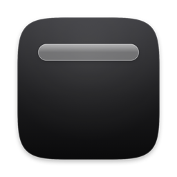
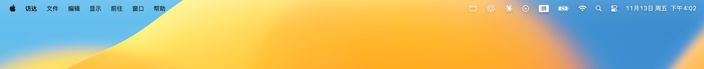

<p align="center"></p>

<h1 align="center">Sheer</h1>

<p align="center">A macOS 26/27-style transparent menu bar for <b>macOS 15 Sequoia</b>.<br>
<a href="#中文说明">中文说明</a></p>

**Before** — the standard macOS 15 menu bar:


**After** — with Sheer:



Sheer removes the frosted background of the macOS 15 menu bar so your wallpaper shows straight through — the way the menu bar looks on macOS 26 and 27. A faint gradient at the top of the wallpaper keeps the menu titles readable, just like the newer systems do.

- **English, 简体中文, 繁體中文.** The menu follows your system language.
- **Native-looking.** Menu titles, the Apple logo and the selection highlight are drawn at the exact size and position of the real menu bar (measured pixel-by-pixel against macOS 15). Clicks go straight to the real menu bar, so everything works as usual.
- **Follows your wallpaper.** Changes are picked up automatically, with a soft crossfade. Still images, dynamic wallpapers and Apple's video wallpapers are read from their files — no screen recording.
- **Stays out of the way.** No settings to tweak. Full-screen apps, auto-hiding menu bars and status items are left untouched. Typical usage is under 0.5% CPU and 40–70 MB of memory.

## Requirements

- macOS 15 Sequoia. Built for macOS 14 and later, but only tested on macOS 15.
- On macOS 26 and later Sheer isn't needed — it tells you so and quits.

## Install

### Download (no developer account needed on either side)

1. Download `Sheer.zip` from the [latest release](../../releases/latest) and unzip it.
2. Move **Sheer.app** to your **Applications** folder.
3. Open it. Sheer isn't notarized by Apple, so macOS blocks it the first time. Go to
   **System Settings → Privacy & Security**, scroll down and click **Open Anyway**.
   (Or run `xattr -dr com.apple.quarantine /Applications/Sheer.app` in Terminal.)
4. Grant **Accessibility** access when asked. That's it.

### Build from source

Needs only the Xcode Command Line Tools (`xcode-select --install`).

```bash
git clone <this repository>
cd sheer
./build.sh
open build/Sheer.app
```

An app you build yourself isn't quarantined, so Gatekeeper won't block it.

## Permissions

| Permission | Why | When |
|---|---|---|
| **Accessibility** | Read the current app's menu titles and their positions so they can be redrawn. | Always (required) |
| **Screen Recording** | Take a single snapshot of the wallpaper when it has no file to read: live wallpapers (e.g. *Macintosh*, Aerials), shuffling wallpapers, or different wallpapers per display or Space. | Only for those wallpapers |

Sheer collects nothing. Its only network request is a once-a-day check of this repository's latest version number on GitHub; if there's a newer one, the Sheer menu shows **Update Available**. Nothing is downloaded or installed automatically.

> macOS 15 periodically asks whether apps may keep recording the screen. You'll only see this with the wallpapers listed above.

## How it works

On macOS 15 the menu bar background and the app menus are drawn together in one WindowServer window; status items are separate windows on a higher level. Sheer places a click-through window between them — above the system menu bar, below the status items — and paints:

1. the strip of wallpaper behind the menu bar,
2. a faint gradient that continues onto the wallpaper below the bar (in a desktop-level window, so it never covers your windows),
3. the menu titles, read through the Accessibility API and drawn with the native metrics.

Placing the window between those two levels uses a private SkyLight call. If a macOS update breaks it, Sheer detects that, pauses itself and leaves the system menu bar as it is.

## Known limitations

- Tested on a MacBook with a notch (37 pt menu bar). Metrics for 24 pt menu bars and multi-display setups are derived, not yet verified — reports welcome.
- Apps that show icons instead of text in their menu titles fall back to the normal menu bar while they're frontmost.
- The light-mode selection highlight colour is an estimate.

## Uninstall

Quit Sheer from its menu, turn off **Launch at Login** if you enabled it, and delete the app. Optionally remove it from **System Settings → Privacy & Security → Accessibility / Screen Recording**.

## Development

```bash
./build.sh --dev   # adds self-check tooling and keeps permissions across rebuilds (local use only)
```

Sources are plain Swift files in `Sources/`; the app icon is drawn in code by `Icon/make_icon.swift`.
Releases are built by GitHub Actions when a `v*` tag is pushed.

## License

[MIT](LICENSE)

---

## 中文说明

Sheer 让 **macOS 15 Sequoia** 的菜单栏变成 macOS 26/27 那样的透明效果：去掉毛玻璃背景，直接显示壁纸，并在壁纸顶部加一层极淡的渐变，保证文字清晰。

真实截图对比（上：macOS 15 原生菜单栏；下：开启 Sheer 后）：


- **和原生一致**：菜单文字、苹果标志、选中高亮的大小和位置都与 macOS 15 原生菜单栏逐像素对齐；点击直接穿透到真实菜单栏，用法完全不变。
- **自动跟随壁纸**：换壁纸后自动更新并淡入淡出。普通图片、动态壁纸和系统视频壁纸都直接读取文件，不需要截屏。
- **零设置**：没有需要调节的选项。全屏应用、自动隐藏菜单栏、右侧状态栏图标都不受影响。通常占用不到 0.5% CPU、40–70 MB 内存。

### 安装

1. 从 [最新版本](../../releases/latest) 下载 `Sheer.zip` 并解压，把 **Sheer.app** 拖进「应用程序」。
2. 打开它。因为没有经过苹果公证，第一次会被系统拦下：到 **系统设置 → 隐私与安全性**，在页面下方点 **仍要打开**。
   （也可以在终端运行 `xattr -dr com.apple.quarantine /Applications/Sheer.app`。）
3. 按提示授予 **辅助功能** 权限即可。

也可以自己编译（只需 Xcode 命令行工具）：`./build.sh`，自己编译的 App 不会被拦。

### 权限

- **辅助功能（必需）**：读取当前应用的菜单文字和位置。
- **屏幕录制（仅特殊壁纸）**：只有 Macintosh、航拍等实时渲染壁纸、随机轮换壁纸、或每个屏幕 / 空间用不同壁纸时，才需要截取一次壁纸画面。

Sheer 不收集任何数据。唯一的联网是每天一次向 GitHub 查询最新版本号；有新版本时，Sheer 菜单里会出现「有新版本」，不会自动下载或安装。macOS 26 及以后已自带透明菜单栏，Sheer 会提示后自动退出。

### 已知限制

- 只在刘海屏 MacBook（37pt 菜单栏）上实测过；普通 24pt 菜单栏和多显示器的效果是推算的。
- 菜单标题是图标而不是文字的应用，在前台时会退回系统原生菜单栏。
